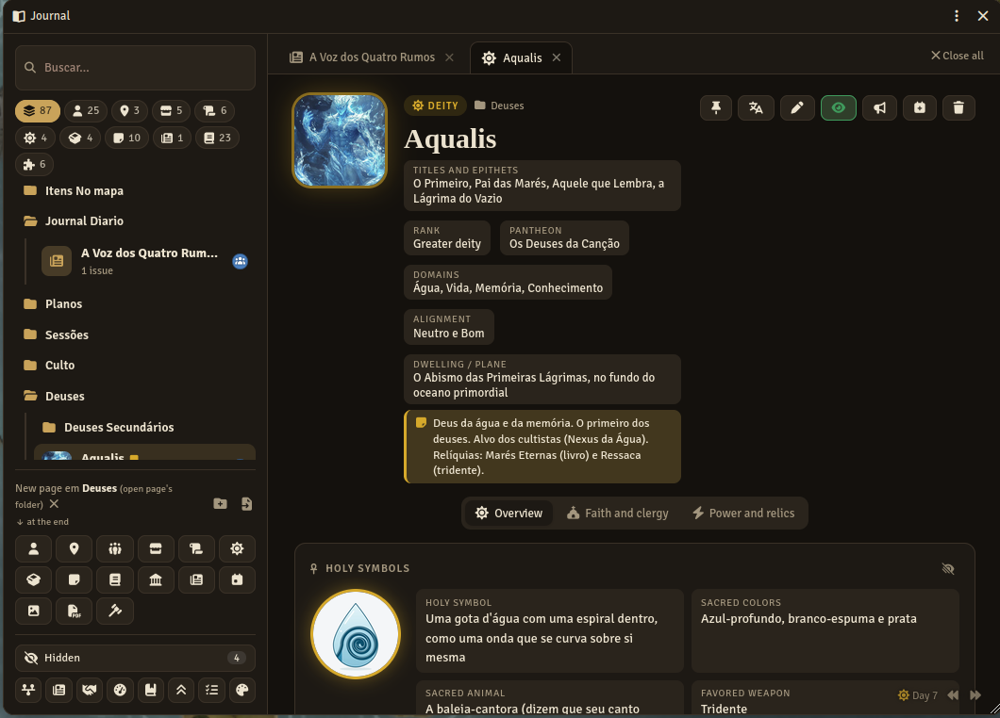
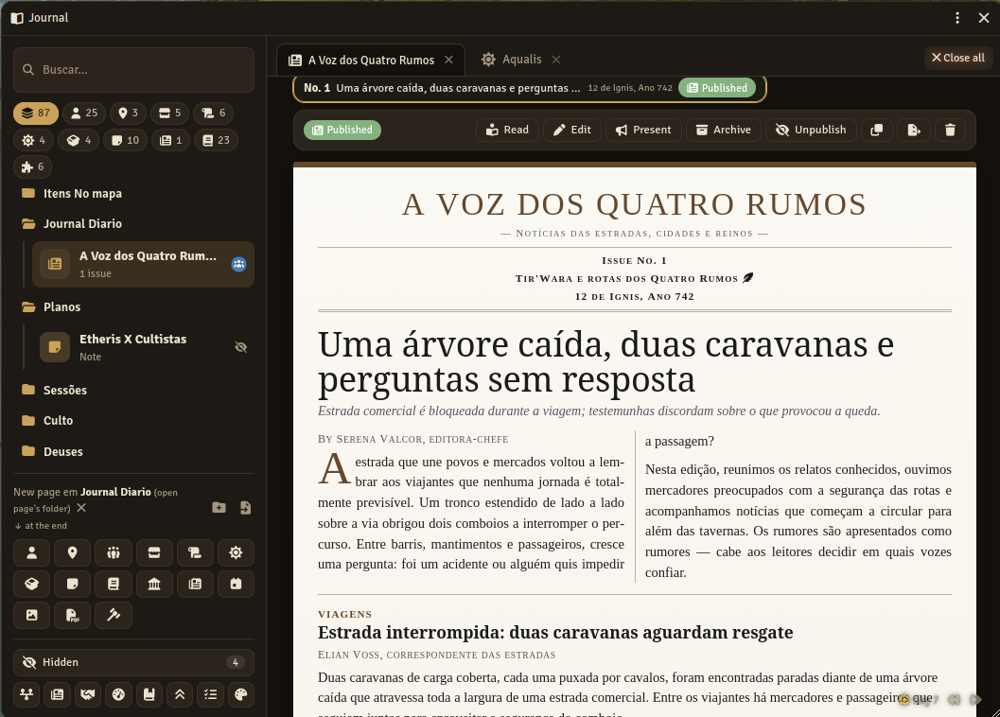
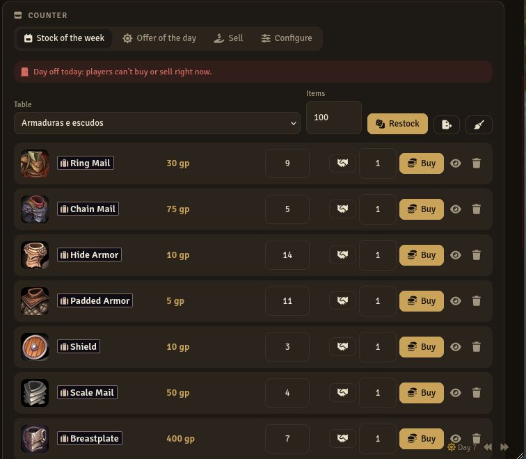
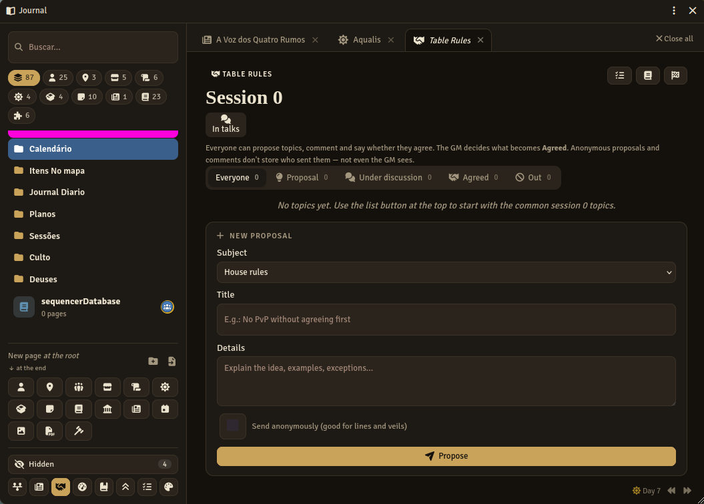

# Journal da Mesa

**Versão 4.10.5** · Foundry VTT 14 · D&D 5e 6 · Português e English · Licença MIT · ✅ Testado e aprovado no Foundry



Módulo para Foundry VTT **14** (versão mínima; verificado no 14.369) com D&D 5e (testado até o 6.0.6). Janela única com abas e pastas para NPCs, locais, organizações, lojas, missões, divindades, baús de saque, História, Regras da Mesa e Jornais e Notícias. É uma alternativa mais simples ao Monk's Enhanced Journal e lê e grava os dados no mesmo formato que ele.

> O Journal da Mesa é um projeto independente: não é afiliado ao Monk's Enhanced Journal nem a seu autor. A compatibilidade é só de formato de dados, para que você possa trocar de um para o outro sem perder nada.

- [Galeria](#galeria)
- [Compatibilidade](#compatibilidade)
- [Instalação e atualização](#instalação-e-atualização)
- [Suporte e sugestões](#suporte-e-sugestões)
- [Como os dados são guardados](#como-os-dados-são-guardados)
- [Tipos de página](#tipos-de-página)
- [Jornais e Notícias](#jornais-e-notícias--imprensa-do-mundo-47)
- [Arquivos do código](#arquivos-do-código-410)
- [Sobre como este módulo foi feito](#sobre-como-este-módulo-foi-feito)
- [Licença e créditos](#licença-e-créditos)
- [English summary](#english-summary)

## Galeria

| Jornal do Dia | Loja | Regras da Mesa |
|---|---|---|
| [](docs/jornal.png) | [](docs/loja.png) | [](docs/regras-da-mesa.png) |

Clique numa imagem para ver em tamanho maior.

## Compatibilidade

| | Mínimo | Testado |
|---|---|---|
| Foundry VTT | 14 | 14.369 |
| D&D 5e | 5.0.0 | 6.0.6 |

**Testado e aprovado.** A versão 4.10.5 foi testada e aprovada pelo autor dentro do Foundry VTT, nas versões indicadas acima (Foundry 14.369 e D&D 5e 6.0.6), antes da publicação. Como em qualquer módulo, recomendamos fazer backup do mundo antes de atualizar.

**Foundry 13 não é mais suportado a partir da 4.9.0.** Quem ainda usa o Foundry 13 deve ficar no Journal 4.8.3 (o Foundry não deixa ativar a 4.9 num mundo v13). Os dados dos mundos não mudam: um mundo que passar do v13 para o v14 abre na 4.9 sem migração.

## Instalação e atualização

### Instalar pelo Foundry (recomendado)

1. No Foundry, vá em **Módulos Complementares → Instalar Módulo**.
2. No campo **URL do Manifesto**, cole:

   ```
   https://github.com/Daphenius/journal-mesa/releases/latest/download/module.json
   ```

3. Clique em **Instalar**, entre no mundo e ative **Journal da Mesa** em *Gerenciar Módulos*.

Instalado assim, o Foundry avisa quando houver versão nova e atualiza pelo botão de atualizar.

### Instalar manualmente

1. Baixe `journal-mesa.zip` na [página de releases](https://github.com/Daphenius/journal-mesa/releases).
2. Extraia em `Data/modules/journal-mesa` (a pasta precisa ter esse nome).
3. Reinicie o Foundry e ative **Journal da Mesa** em *Gerenciar Módulos* no seu mundo.

### Atualizar manualmente

Apague a pasta `Data/modules/journal-mesa` e extraia a versão nova no lugar. Os diários ficam salvos no mundo, não na pasta do módulo, e são mantidos entre versões. Mesmo assim, faça backup do mundo antes de atualizar.

### Módulos recomendados (opcionais)

- **Calendário da Mesa**: linha do tempo, prazos, dias sagrados, horário das lojas e Nexus ligados ao clima.
- **Dados em Cena**: tela de rolagem da pechincha para o jogador.
- **Item Piles**: baús de saque como pilhas no mapa.
- **Translate All**: tradução das páginas.

---

## Suporte e sugestões

Encontrou um problema ou tem uma ideia? Abra uma [Issue no GitHub](https://github.com/Daphenius/journal-mesa/issues).

Para relatar um problema, inclua:

- versão do **Foundry VTT**, do sistema **D&D 5e** e do **Journal da Mesa**;
- outros módulos ativos que possam estar envolvidos (Calendário da Mesa, Item Piles, Monk's Enhanced Journal…);
- **passo a passo** para o problema acontecer;
- o que você esperava e o que aconteceu;
- a **mensagem de erro** do console (aperte **F12**, aba *Console*), se houver. Ela mostra em qual arquivo do módulo o erro aconteceu;
- se possível, uma captura de tela ou a página exportada em JSON (botão direito → Exportar JSON).

---

## Como os dados são guardados

Tudo é Diário nativo do Foundry, nas Pastas comuns. A descrição fica no texto da página, a imagem no campo de imagem da página, e tipo, conexões, estoque, baús, objetivos, ator ligado e notas pessoais ficam no **mesmo formato do Monk's Enhanced Journal**. Desativar o Journal da Mesa ou o Monk's não apaga os dados, que continuam nos Diários do mundo, e o Journal da Mesa funciona com o Monk's ligado ou desligado.

## Tipos de página

- NPC, Local, Organização, Loja, Missão, Anotação e Baú — mesmo formato do Monk's.
- **Divindade** — abas Visão geral (posição, panteão, domínios, símbolos sagrados com imagem, aparência, mitos), Fé e clero (dogmas, tabus, clero, ritos, dias sagrados, quem cultua) e Poder e relíquias (dádivas, castigos, Caminhos e Sequências, relíquias arrastáveis). Para o Monk's ela aparece como uma Anotação normal.
- **Diário** — o diário comum do Foundry, com várias páginas: texto, imagem, PDF, vídeo e os tipos do D&D 5e (regra, lista de magias, classe, subclasse, mapa). Adicione páginas pelos botões no fim do diário.
- **História** — diário dos acontecimentos do mundo, ligado à Linha do tempo (veja abaixo).
- **Jornal** — uma publicação do mundo, com edições (veja **Jornais e Notícias**).
- Atalhos para criar direto: **Imagem**, **PDF** e **Regra**.

## Lojas: vender e pechinchar

- Aba **Vender**: mostra o inventário do seu personagem. A loja paga 65% do valor; o item vendido entra no estoque da loja.
- Campo de **quantidade** na compra e na venda (ex.: comprar 10 poções).
- Botão de **aperto de mão** (comprar ou vender): Persuasão do jogador contra a perícia do vendedor (Persuasão, Intuição ou Enganação). Uma tentativa por item por dia.
  - Com **Pechincha interativa no chat** ligada (configurações do módulo), aparece um cartão no chat: o jogador clica no dado dele, o mestre no do vendedor (D = desvantagem, V = vantagem). Clique no nome de cada um para ver os dados (com vantagem/desvantagem aparecem os dois d20).
  - As porcentagens de cada resultado ficam numa tabela editável em **Configurar** (padrão: compra −35/−10/0/+10/+35%; venda 100/75/65/55/40% do valor).
- O mestre muda o estoque de cada item direto na lista, sem entrar em edição.
- O vendedor usa a ficha ligada ao NPC dono da loja; sem ficha, usa o bônus definido em Configurar.

## Tabelas de itens das lojas (4.7.2)

Configurações do módulo › **Tabelas de itens das lojas** › Escolher tabelas:
- **Criar tabelas prontas** a partir de um compêndio de itens (ex.: o do D&D 5e): armas, armaduras e escudos, equipamento de aventura, poções e consumíveis e itens mágicos por raridade, na pasta "Journal — tabelas das lojas". Os resultados apontam para o compêndio.
- **Tabelas padrão** do estoque semanal e das ofertas diárias: valem para as lojas que não escolheram uma tabela.
- **Tabelas que aparecem nas lojas**: marque só as de itens para a lista da loja ficar curta (nenhuma marcada = todas).

Dias de folga: clique nos dias na aba Configurar da loja; marcar uma folga liga "Respeitar horário e folgas".

## Recompensas de missão

No formato do Monk's: XP, moedas com ícone (as moedas habilitadas no mundo, inclusive as do **Custom DnD5e**) e itens, talentos ou magias arrastados para o painel. **Entregar** abre uma janela para escolher quem recebe, o XP de cada um, como dividir as moedas e para quem vai cada item (ou deixar para pegar).

## Fixar páginas (4.4)

O alfinete no topo de qualquer página (ou "Fixar" no botão direito) deixa a página **no topo da lista**, numa seção "Fixados", e **sempre aberta** como uma das primeiras abas, sem o X. "Fechar todas" não fecha as fixadas. Cada usuário tem os próprios fixados.

## Regras da Mesa — sessão 0 (4.4)

Botão de aperto de mão no rodapé do Journal da Mesa. Um lugar para mestre e jogadores combinarem a mesa:

- Tópicos por assunto: regras da casa, limites e véus, ferramentas de segurança, tom e expectativas, personagens e grupo, logística.
- **Todos** podem propor tópicos, comentar e marcar **Concordo / Não concordo**. Propostas e comentários podem ser **anônimos** — nesse caso ninguém, nem o mestre, vê quem enviou (bom para limites e véus).
- O **mestre** muda o status (Proposta, Em discussão, Combinado, Fora), edita, apaga, adiciona os **tópicos comuns de sessão 0** com um clique e marca a sessão 0 como concluída.
- **Gerar diário** cria (ou atualiza) o Diário "Regras da Mesa", visível para todos, só com o que virou Combinado.

## Organização

- Pastas nativas, com as cores que você já usa. Arraste páginas e pastas para organizar.
- **Ordem**: arraste para a borda de cima ou de baixo de uma pasta/página para colocar antes ou depois; no meio de uma pasta, para colocar dentro.
- Clique em qualquer lugar do Journal da Mesa (fora das pastas) para desmarcar a pasta escolhida.
- **Páginas novas** nascem na pasta clicada; se nenhuma pasta estiver marcada, na pasta da página aberta (o X em "Nova página em..." cria na raiz). Elas entram no **fim** ou no **início** da pasta, conforme a configuração "Onde colocar páginas novas". Vale também para o botão da aba de Diários do Foundry.
- **Ocultar pasta** (olho riscado na pasta ou botão direito): a pasta e os diários dela somem da lista, dos filtros e da aba de Diários do Foundry, sem apagar nada. Ficam em **Ocultos**, no rodapé do Journal da Mesa, de onde dá para mostrar de novo.
- O **dia** do mundo fica no canto de baixo da página aberta, com botões de voltar e avançar o dia.
- **Nota do mestre**: lembrete rápido em cada página (no topo da página ou botão direito). Só o mestre vê; aparece ao passar o mouse na lista do Journal da Mesa e na aba de Diários do Foundry.
- **Lixeira** no topo de cada página (pede confirmação antes de apagar).
- **Botão direito** numa página ou pasta: renomear, quem vê, duplicar, exportar/importar JSON, configurar pasta (nome, cor, ordem), apagar.
- Na aba de Diários do Foundry: botão **+ Página do Journal da Mesa** e opção "Nova página do Journal da Mesa" no botão direito das pastas.

## Quem vê

- O olho abre a janela **Quem vê**: nível para todos e para cada jogador (Nada, Limitado, Observador, Dono). Verde = todos veem; amarelo = só alguns.
- **Limitado** agora mostra a página (nome, imagem, dados do topo, loja, conexões visíveis...), mas **sem as caixas de texto**.
- **Revelar por partes**: cada caixa de texto (descrição, mitos, dogmas, clero, símbolos, relíquias, objetivos, recompensas, páginas de um diário...) tem um olho no título. Opções: seguir a permissão da página, revelar a todos que veem a página, esconder (só o mestre) ou marcar jogador por jogador. Assim o jogador pode ter Limitado na página e ir ganhando acesso a cada parte conforme descobre. Olho cinza = padrão, verde = todos, amarelo = alguns, vermelho = escondido.
- **Bolinhas** com a inicial de cada jogador que tem acesso (como o Ownership Viewer), no Journal da Mesa e nas abas de Atores, Itens, Diários, Cenas, Tabelas e Macros. Clique para mudar. Dá para desligar nas configurações.
- **Botão direito numa imagem** do Journal da Mesa: mostrar aos jogadores só a imagem, a imagem com o nome, ou só para um jogador.
- O **megafone** abre a página só na tela dos jogadores online que têm permissão de ver (Limitado ou mais). Se ninguém tiver, oferece abrir o "Quem vê".
- **Fechar todas** as abas no canto da barra de abas (só fecha, não apaga).

## Baú de saque

- Ao encerrar um combate, o Journal da Mesa pergunta se você quer um **Baú** com os itens e moedas dos inimigos derrotados (armas naturais e magias ficam de fora). Também dá para gerar pelo botão 📦 no rodapé enquanto o combate existe.
- O baú vai para a pasta **Saques**, oculto. Mostre aos jogadores quando quiser.
- Jogadores clicam em **Pegar**; o mestre pode **Dividir moedas** igualmente entre os personagens.
- Com o **Item Piles** ativo, aparece **Colocar no mapa**: cria uma pilha no centro da tela com tudo do baú.

## Itens

- Lojas e baús têm **Exportar para a aba Itens**.
- **Importar JSON** (lateral ou botão direito numa pasta): aceita diários exportados pelo Foundry, pelo Monk's ou pelo Journal da Mesa (pasta inteira, recria as subpastas) e itens (vão para a aba Itens, mantendo o ID do arquivo para que relíquias e links continuem ligados).

## Integrações

- **Ficha nativa**: na aba de Diários e nos links, clicar num diário abre no Journal da Mesa **só se ele usar a ficha padrão (do Foundry ou do sistema) ou a ficha "Journal da Mesa"**. Diários com a ficha de outro módulo (Heavy Lore, Monk's...), escolhida no diário ou como padrão do mundo, abrem na janela desse módulo. Dá para desligar nas configurações. Também existe a ficha "Journal da Mesa (janela única)" em *Configurar Ficha* e a opção "Abrir no Journal da Mesa" no botão direito da barra lateral.
- **Translate All**: o botão de tradução (ícone de idioma) abre a página nativa, onde fica o botão do Translate All. A tradução é gravada no texto da página e o Journal da Mesa mostra na hora.
- **Item Piles**: veja Baú de saque.

## Calendário

Funciona com o calendário do Foundry; com o **Calendário da Mesa** (2.5 ou mais novo) ativo, usa os meses e dias da semana dele.

- **Data de qualquer nota**: na seção Calendário da página, escolha dia, mês e ano direto (ou use −7, −1, +1, +7 e Hoje). Também: hora, **repetição** (a cada N dias, semanas, meses ou anos; dias da semana; "2ª terça do mês"; último dia), duração, quando termina (nunca, numa data, depois de N vezes), ícone, cor e aviso no chat. Grava no mesmo lugar que o calendário usa, então aparece nele na hora.
- **Dias sagrados das divindades**: na aba Fé e clero de uma Divindade, "Novo dia sagrado" cria uma festa que se repete todo ano (ou a cada N anos), ligada àquela divindade. Ela aparece no calendário e a página da festa mostra "Dia sagrado de ...". Nada vem pronto: você cria as suas.
- **Prazo nas missões**: "Definir prazo" na missão. O rastreador e a página mostram quantos dias faltam. Quando o prazo passa, o mestre recebe um aviso; se escolher "Falhar a missão", ela é marcada como Falhou sozinha.
- **Horário das lojas**: em Configurar da loja, ligue o horário, escolha abertura, fechamento e dias de folga. Fechada, os jogadores não compram nem vendem (o mestre vê um aviso). O Calendário da Mesa mostra as mesmas informações.
- **Linha do tempo** (botão no rodapé): o que já aconteceu, agrupado por dia e por ano, com o nome da era (acontecimentos da História, eventos, missões concluídas, sessões, limiares dos Nexus e, se quiser, o histórico do calendário), e os próximos 30 dias (eventos, prazos, acontecimentos, eventos das luas e contadores do calendário que terminam). Com vários calendários, mostra só os eventos do calendário em uso, como a grade do Calendário. No painel do dia do Calendário (4.2+), o botão **Linha do tempo** abre a Linha já naquele dia. Veja **História**.
- Botão **Evento do calendário** em "Nova página" e botão 📅+ no topo de qualquer página.

## História

Diário próprio para a história do mundo e da campanha. Crie pelo botão **História** (marco) em "Nova página". Cada página é um **acontecimento** com data, ícone e cor.

- **Ordem cronológica**, separada por ano. "Sem data" fica no fim. Botão para inverter a ordem (mais antigos ou mais recentes primeiro).
- **Data, ícone e cor**: em "Data, ícone e cor" dentro de cada acontecimento (só o mestre). Serve para qualquer época, até séculos antes do dia atual.
- **Ligação com a Linha do tempo**:
  - todo acontecimento com data aparece na Linha do tempo, no dia dele (filtro **História**); os que ainda vão acontecer aparecem em "Próximos 30 dias";
  - na Linha do tempo, a **pena** ao lado de uma missão, sessão, evento ou item do histórico do calendário registra aquilo na História (com link para a página de origem). Depois de registrado, a pena vira um **marco** que abre o acontecimento;
  - o **+** ao lado de cada dia registra um acontecimento novo naquele dia, e os botões no topo da Linha do tempo abrem a História ou registram um acontecimento;
  - no acontecimento, o botão da linha do tempo abre a Linha do tempo já no dia dele;
  - a Linha do tempo agora separa os dias por ano e mostra datas distantes em meses ou anos ("há 300 anos").
- **Diário de sessão**: ao encerrar a sessão, escolha "Registrar na História" para criar um acontecimento com o resumo e o link do diário da sessão.
- **Quem vê**: igual ao diário comum. Cada acontecimento tem o olho de "revelar por partes"; o jogador só vê na Linha do tempo os acontecimentos que pode ler.
- Dá para ter mais de uma História (ex.: "História de Aldoria" e "Crônicas do grupo"); ao registrar, você escolhe em qual.
- Também aceita páginas de imagem, PDF, vídeo etc. (botões no fim), que podem ganhar data como qualquer acontecimento.

## Jornais e Notícias — imprensa do mundo (4.7)

**Ler**: uma edição publicada abre numa **janela de jornal** — a folha impressa (cabeçalho, faixa da edição, manchete com imagem, coluna de destaques e, embaixo, Outras notícias, Rumores e Anúncios e avisos), rolável com o mouse. Edição grande segue em mais páginas (página 2, 3...), com botões de página e de edição anterior/próxima. O aviso no chat tem "Ler a edição". O mestre edita numa janela separada (Editar); a leitura nunca mostra a veracidade, nem para o mestre (use a página do jornal no Journal da Mesa para ver as marcas).

**Vínculos**: em cada matéria, **Vincular** abre uma busca com NPCs, locais (cidades, reinos), organizações, missões, divindades, lojas, eventos do calendário, outros diários, personagens, atores e itens (marque vários) e aceita colar um UUID; também dá para arrastar da barra lateral. Cada vínculo mostra o nome, abre o documento e sai com o X. Fica guardado só o UUID.

**Idioma**: todo o Journal da Mesa segue o idioma do Foundry (português ou inglês, pasta `lang/`).

**Editor em etapas (4.8)**: Capa, Manchete, Notícias, Rumores, Avisos, Classificados, Final e Prévia, com uma explicação em cada etapa.

**JSON (4.8)**: Exportar JSON numa edição; Nova edição a partir desta; Importar edição (colar ou arquivo) na página do jornal. O importador aceita o JSON exportado (também dentro de um bloco ```json), nomes de seção em português ou inglês e vínculos pelo nome. Limites (4.9): até 2 MB de texto, 50 edições por importação e 60 matérias por edição; o que passa disso, nomes não achados ou repetidos, número de edição repetido e formato desconhecido aparecem no aviso ao final. JSON inválido não cria nada.

**HTML seguro (4.9)**: o texto das matérias é limpo antes de ir para a tela e para a página nativa (sai script, iframe, svg, atributos on*, links javascript:), com ou sem o limpador do Foundry. A formatação do editor fica.

**Foto do vínculo**: ligar um NPC, local, organização ou ator com imagem põe a foto com o nome dentro da notícia (a câmera no vínculo liga e desliga). O jogador só vê quem já pode ver.

Botão do jornal no rodapé: abre a aba **Jornais e Notícias**, com todos os jornais, quantas edições cada um tem, a última publicada, as programadas e os rascunhos, busca e filtros. O mestre cria jornais (+) e edições.

- **Jornal** (uma publicação): nome, subtítulo, lema, logotipo, descrição, região de circulação, organização responsável (uma página de Organização ou texto), estilo e cor. Fica como um Diário comum, numa pasta qualquer.
- **Quem lê**: é a permissão do jornal — o olho no topo da página dele, como em qualquer página do Journal da Mesa. Um jornal clandestino pode circular só para dois jogadores, por exemplo.
- **Edição**: número, data do mundo, manchete (título, subtítulo, imagem, autor ou editor, texto), matérias em quatro seções (**Notícias**, **Rumores**, **Avisos públicos**, **Classificados e anúncios**) e rodapé. Cada matéria tem título, texto (caixa de texto do Foundry), imagem, categoria e autor fictício, e pode ser ligada a NPCs, personagens, locais, organizações, missões, eventos do calendário ou outras páginas (escolha na lista ou arraste). As matérias podem ser reordenadas.
- **Três estilos**: **Clássico Medieval** (pergaminho e ornamentos), **Gazeta Elegante** (capital de reino) e **Jornal Clandestino** (panfleto datilografado). Trocar o estilo não mexe nas matérias. Sem fontes ou imagens de fora.
- **Estados**: **Rascunho** (só o mestre), **Programada** (só o mestre, até a data), **Publicada** (quem lê o jornal lê a edição, inclusive depois, mesmo quem estava desconectado) e **Arquivada** (continua legível; fica no "Arquivo"). Despublicar volta a rascunho sem apagar nada. Salvar no editor nunca publica.
- **Publicar**: avisa no chat (só quem pode ler recebe o aviso) e, se quiser, abre a edição na tela dos jogadores conectados. Depois, **Apresentar** abre de novo quando você quiser.
- **Programar**: escolha o dia. Quando o dia chega, a edição publica sozinha (ou só avisa você, se desmarcar). Vale com pulos grandes de tempo e com o mundo fechado: o mestre, ao entrar, publica as que venceram. Cada edição publica uma vez só.
- **Veracidade** (só o mestre): cada matéria pode ser marcada como Informação verdadeira, Rumor, Manipulada, Propaganda, Não confirmada ou Comunicado oficial, com uma nota. Isso e a nota da edição ficam fora da página que os jogadores leem. **Ver como jogador** esconde essas marcas para você conferir a edição.
- **Notícias relacionadas**: NPCs, locais, organizações, missões e divindades mostram as matérias publicadas ligadas a eles. Uma página ligada que o jogador não pode ver não aparece na matéria (o jornal não compartilha nada sozinho).
- **Linha do tempo**: edições publicadas aparecem no dia delas (filtro **Jornais**); a pena registra a edição na História. As programadas aparecem para o mestre em "Próximos 30 dias". Dá para desligar em Configurações ("Jornais na Linha do tempo").
- **Diário de sessão**: anota as edições publicadas.
- **Sem o Calendário da Mesa**: usa o calendário nativo do Foundry. Sem nenhum calendário, a data vira um texto livre e não dá para programar (publique na mão).

**Limite do Foundry sobre segredos**: o Foundry envia todos os documentos e configurações do mundo para todos os jogadores, e a permissão só esconde da interface. Um jogador que abra o console do navegador (F12) consegue ler rascunhos, a veracidade das matérias ou qualquer outro dado escondido, de qualquer módulo. O Journal da Mesa garante que nada disso aparece na janela, na ficha padrão, no chat, na Linha do tempo ou na API; não consegue impedir o console. No Jornal, a veracidade e as notas do mestre ficam numa configuração de mundo (`jornalSegredos`) e, por isso, também chegam ao navegador dos jogadores. Esconder algo na tela não é sigilo; veja AUDITORIA.md (item D) para a alternativa proposta.

API (só o que quem chama pode ler): `game.modules.get("journal-mesa").api.jornais.lista()`, `.edicoes(idDoJornal)`, `.abrir(idDoJornal, idDaEdição)`.

## Diário de sessão

**Transcritor da Mesa**: para transcrever o áudio da sessão e apontar os acontecimentos, use o Transcritor da Mesa (programa à parte). Na janela de encerrar a sessão, **Copiar o registro da sessão** leva o que o Journal da Mesa anotou para o campo Contexto do Transcritor, e o diário que ele copia ('Copiar para o Journal da Mesa') vai no Resumo.


Botão do livro no rodapé (mestre): começa a anotar a sessão. O Journal da Mesa registra compras, vendas, saques, recompensas, missões concluídas ou falhas, prazos vencidos, combates, dias que passaram e limiares dos Nexus. Ao encerrar, cria um diário na pasta **Sessões** com tudo separado por assunto, mais o seu resumo (e o histórico do calendário, se quiser). Em Configurações dá para fazer a sessão começar sozinha ao abrir o mundo.

## Nexus (opcional)

Ligue **Medidor dos Nexus** nas configurações do módulo. Aparece a aba Nexus: um medidor de 0 a 100% para cada Nexus, com nome, cor e ícone. Os **limiares** avisam o mestre quando o valor cai abaixo deles. Os jogadores veem os medidores visíveis se a opção "Jogadores veem os Nexus" estiver ligada.

**Anomalia no clima** (com o Calendário da Mesa): escolha a anomalia e onde ela vale.
- **na região da anomalia** (padrão, Calendário 4.2+): o limiar liga o "Usar como região" da anomalia; as Regiões do mapa e as cenas marcadas com a região dela passam a ter o clima drenado. Funciona com a opção padrão do Calendário.
- **numa região inteira** (o jeito antigo): a anomalia cobre uma região inteira (Temperada, Reino da Água...). Precisa de "Anomalia cobrindo uma região inteira" ligada no Calendário; sem ela, o Journal da Mesa avisa no próprio medidor. Nexus criados antes da 4.6 com uma região escolhida continuam assim.
- Ao subir acima de todos os limiares com anomalia, ela desliga — a não ser que outro Nexus com a mesma anomalia ainda esteja drenado. O selo **ativa/inativa** mostra o estado, e o botão ao lado liga ou desliga na hora.
- Com a barra de Anomalias desligada no Calendário, o medidor avisa e os limiares só mandam o aviso.

Cada limiar cruzado (caindo ou voltando) fica no histórico do medidor e aparece na Linha do tempo (filtro **Nexus**), com a pena para registrar na História.

API: `game.modules.get("journal-mesa").api.nexus.lista()` e `.nexus.definir(id, valor)`; `api.linhaDoTempo(td)` abre a Linha do tempo num dia.

## PDF

As páginas PDF abrem no leitor de PDF do próprio Foundry, com uma barra de **busca** em cima (Enter = próximo, Shift+Enter = anterior). Dentro do PDF, o Ctrl+F do leitor também funciona.

## Abrir sempre no Journal da Mesa (4.4)

Com "Abrir diários sempre no Journal da Mesa" ligado (padrão), **qualquer** abertura de um diário vai para o Journal da Mesa, na página certa: notas no mapa, links, barra lateral, macros e outros módulos. Diários com a ficha de outro módulo (Heavy Lore, Monk's...) continuam abrindo nela. "Abrir na ficha padrão" (botão direito) ainda abre a ficha do Foundry.

## Lojas com o Calendário da Mesa (4.4)

- Opção **Renovar o estoque das lojas a cada nova semana**: quando o calendário vira a semana, as lojas com tabela de estoque rolam o estoque novo sozinhas. Desligada, o calendário só lembra você no chat (como antes).
- O horário das lojas segue a mesma regra nas duas telas: loja só do Monk's usa a abertura e o fechamento dele também no Journal da Mesa.
- **Pechincha** (4.5): o jogador rola. Com o **Dados em Cena** ativo, a tela de rolagem abre para ele (e para você, com o vendedor, se ele tiver ficha): ele escolhe vantagem ou desvantagem e clica no d20. Sem o módulo, ele clica no cartão do chat. Nos dois casos o teste usa a ficha dele, os dados 3D aparecem com as cores dele, e o número é sorteado no computador do mestre, o que impede o jogador de escolher o resultado pelo console.

## Links

Links para diários e páginas (`@UUID[...]`, inclusive para um título dentro da página) abrem no Journal da Mesa, numa aba nova, rolando até o ponto certo.

## Dicas

- Se o editor de descrição não deixar digitar, mude **Editor de descrição** para "Simples" nas configurações do módulo, ou use o botão de expandir no título da Descrição para abrir o editor completo do Foundry.

- Deixe só um ativo, Journal da Mesa ou Monk's, para não abrirem duas janelas.
- Para comprar ou pegar itens, o jogador precisa ter o personagem definido ou o token selecionado, e o mestre precisa estar online.
- Macro para abrir: `game.modules.get("journal-mesa").api.abrir()`
- API nova (4.4): `api.dia.get()`, `api.dia.somar(n)`, `api.renovarEstoques()`, `api.fixados()`.

## Arquivos do código (4.10)

`scripts/journal.js` é a porta de entrada e carrega o resto:

- `nucleo.js`: o núcleo;
- `partes/`: janela, calendário, história, pechincha, sessão, tempo, barra lateral e versão dos dados;
- `jornal/`: Jornal de Notícias;
- `lojas/`: tabelas das lojas;
- `idioma.js`: textos.

Um erro no console (F12) mostra em qual desses arquivos ele aconteceu.

| Arquivo | Para quê |
|---|---|
| `module.json` | manifesto do módulo |
| `CHANGELOG.md` | histórico de versões |
| `AUDITORIA.md` | auditoria técnica da 4.9 (segurança, achados e o que foi corrigido) |
| `LICENSE` | licença MIT |
| `docs/` | imagens deste README (topo e galeria) |
| `.github/workflows/release.yml` | monta e anexa o ZIP e o `module.json` ao publicar uma release |

---

## Sobre como este módulo foi feito

Sei que parte da comunidade não gosta de módulos produzidos com IA, então prefiro ser transparente: este foi desenvolvido com ajuda de IA. Não sou programador.

Tudo começou quando um amigo me disse: “cara, ficou muito mais simples, é só fazer uma macro do que você quer”. Fiz a macro para a minha mesa, fui adaptando conforme a necessidade dos jogos e, no fim, ela virou um módulo. Uso nas minhas próprias sessões e resolvi compartilhar caso seja útil para mais alguém.

Se encontrar bugs ou tiver sugestões, abra uma [issue](https://github.com/Daphenius/journal-mesa/issues). Todo retorno é bem-vindo.

---

## Licença e créditos

Distribuído sob a **licença MIT**: você pode usar, copiar, modificar e redistribuir, inclusive em projetos comerciais, desde que mantenha o aviso de copyright e a licença. Veja o arquivo [`LICENSE`](LICENSE).

Copyright © 2026 Daphenius.

Idealizado e desenvolvido por Daphenius, com auxílio de Claude e ChatGPT na elaboração, revisão e refatoração do código. A definição das funcionalidades, as decisões do projeto e os testes dentro do Foundry VTT foram realizados pelo autor.

Monk's Enhanced Journal, Item Piles, Translate All, Heavy Lore e Ownership Viewer são módulos de seus respectivos autores e são citados aqui só para explicar a compatibilidade.

---

## English summary

**Journal da Mesa** is a single-window journal for Foundry VTT 14 and D&D 5e, with tabs and native folders for NPCs, locations, organizations, shops (weekly stock, daily offers, selling and haggling), quests with rewards and deadlines, deities, loot chests, a world History linked to a timeline, Table Rules (session 0), and an in-world newspaper system with scheduled issues. Everything is stored as native Foundry journals, in the same data format as Monk's Enhanced Journal, so you can switch between the two without losing data (this is an independent project, not affiliated with Monk's Enhanced Journal). The interface is available in Portuguese and English.

Version 4.10.5 was tested and approved by the author in Foundry VTT (14.369) with D&D 5e (6.0.6) before release. Install from Foundry with the manifest URL `https://github.com/Daphenius/journal-mesa/releases/latest/download/module.json` (or extract the release ZIP into `Data/modules/journal-mesa`) and enable it. Optional integrations: Calendário da Mesa, Dados em Cena, Item Piles and Translate All. Issues and suggestions: [GitHub Issues](https://github.com/Daphenius/journal-mesa/issues). Licensed under MIT.

**How this module was made:** I know part of the community doesn't like AI-made modules, so I'd rather be transparent: this one was developed with the help of AI. I'm not a programmer. It started as a macro for my own table, grew as our games needed more, and ended up as a module. I use it in my own sessions and decided to share it in case it's useful to someone else. If you find bugs or have suggestions, please open an issue. All feedback is welcome.
